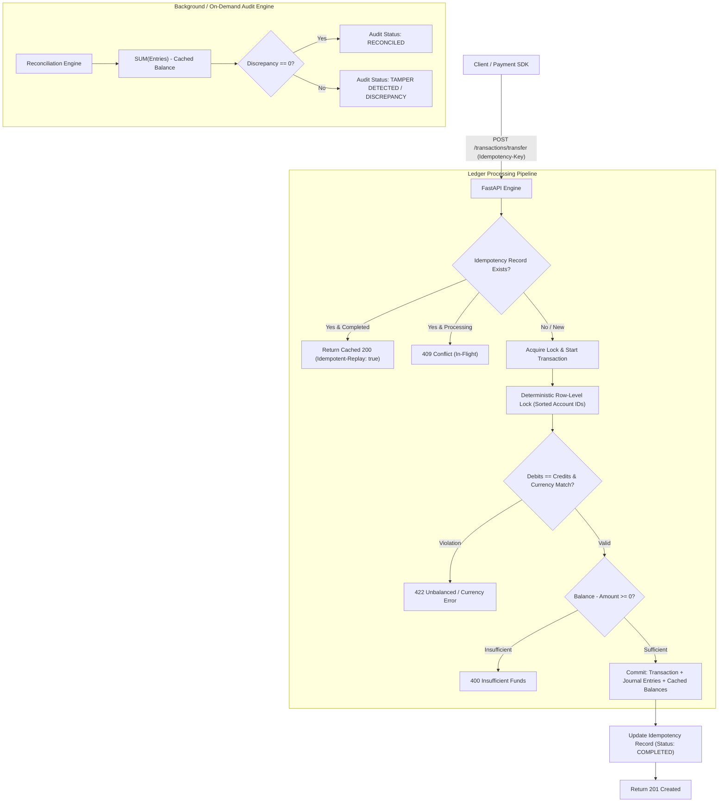

# 💳 Double-Entry Financial Ledger & Wallet Engine

[](https://www.python.org/)
[](https://fastapi.tiangolo.com/)
[](https://www.sqlalchemy.org/)
[-brightgreen.svg)]()
[]()

> A production-grade, concurrency-safe financial ledger and digital wallet platform built with Python, FastAPI, and SQLAlchemy. Engineered to meet **Stripe's** engineering standards for financial correctness, auditability, high throughput, and developer experience.

---

## 📑 Table of Contents
1. [Core Financial & Engineering Principles](#-core-financial--engineering-principles)
2. [System Architecture](#-system-architecture)
3. [Concurrency Control & Deadlock Prevention](#-concurrency-control--deadlock-prevention)
4. [Stripe-Grade Idempotency Engine](#-stripe-grade-idempotency-engine)
5. [Continuous Audit & Reconciliation Engine](#-continuous-audit--reconciliation-engine)
6. [Project File Structure](#-project-file-structure)
7. [Getting Started & Local Setup](#-getting-started--local-setup)
8. [Running the Test Suite](#-running-the-test-suite)
9. [API Reference & Payload Examples](#-api-reference--payload-examples)
10. [Architectural Decisions & Tradeoffs (The "Why")](#-architectural-decisions--tradeoffs-the-why)

---

## 🏛️ Core Financial & Engineering Principles

### 1. Strict Double-Entry Bookkeeping
Money never appears or disappears into thin air. Every transaction consists of at least two journal entry legs (postings) where:

$$\sum \text{Debits} = \sum \text{Credits}$$

Accounts follow standard financial classifications with strict normal balances:
- **`ASSET`** (e.g., Bank Reserves, Cash): Normal balance is **DEBIT** ($+$Debit, $-$Credit).
- **`LIABILITY`** (e.g., Customer Wallets): Normal balance is **CREDIT** ($+$Credit, $-$Debit).
- **`EQUITY`** (e.g., Retained Earnings): Normal balance is **CREDIT**.
- **`REVENUE`** (e.g., Processing Fees): Normal balance is **CREDIT**.
- **`EXPENSE`** (e.g., Interchange Fees): Normal balance is **DEBIT**.

### 2. Elimination of Floating-Point Drift
Floating-point numbers (`0.1 + 0.2 != 0.3`) cause silent rounding drift that is catastrophic in financial software. All monetary amounts are stored as **64-bit integers in minor currency units (cents)**. `$100.50` is stored as `10050`.

### 3. Append-Only Immutability
Transactions and journal entry legs are strictly immutable. Once posted, records are **never modified or deleted** (`UPDATE` and `DELETE` queries are prohibited on ledger tables). Erroneous transfers are corrected exclusively through **compensating reversal transactions**, providing an unbroken audit trail for SOC 1, SOC 2, and SOX compliance.

---

## 📐 System Architecture

### High-Level System Flow (Mermaid)



### ASCII Architecture Diagram

```
+---------------------------------------------------------------------------------+
|                                 FASTAPI ENGINE                                  |
+---------------------------------------------------------------------------------+
          |                                                   |
          v                                                   v
+-----------------------+                           +-----------------------------+
|   ACCOUNTS ROUTER     |                           |     TRANSACTIONS ROUTER     |
|   /api/v1/accounts    |                           |     /api/v1/transactions    |
+-----------------------+                           +-----------------------------+
          |                                                   |
          v                                                   v
+-----------------------+                           +-----------------------------+
|    ACCOUNT SERVICE    |                           |       IDEMPOTENCY LAYER     |
|  - Wallets & Entities |                           |  - SHA-256 Request Hashing  |
|  - Materialized State |                           |  - Replay Cache Injection   |
+-----------------------+                           +-----------------------------+
                                                              |
                                                              v
                                                    +-----------------------------+
                                                    |    DOUBLE-ENTRY ENGINE      |
                                                    |  - Sum(Debits) == Sum(Cred) |
                                                    |  - Currency Uniformity      |
                                                    |  - Deterministic Lock Order |
                                                    +-----------------------------+
                                                              |
                                                              v
+---------------------------------------------------------------------------------+
|                       PERSISTENCE & RECONCILIATION LAYER                        |
|                                                                                 |
|   +-------------------+    +---------------------+    +---------------------+   |
|   |     accounts      |    |    transactions     |    |       entries       |   |
|   |  - cached_balance |    |  - idempotency_key  |    |  - amount (cents)   |   |
|   |  - CHECK (>= 0)   |    |  - status: POSTED   |    |  - DEBIT / CREDIT   |   |
|   +-------------------+    +---------------------+    +---------------------+   |
|             ^                         ^                          ^              |
|             +-------------------------+--------------------------+              |
|                                       |                                         |
|                     AUDIT & RECONCILIATION ENGINE                               |
|                     - Recalculates: SUM(Entries) vs cached_balance              |
|                     - Global Ledger Zero-Sum Verification                       |
+---------------------------------------------------------------------------------+
```

---

## 🔒 Concurrency Control & Deadlock Prevention

### 1. The Race Condition Threat (Double-Spend)
Suppose Alice holds \$100.00 (10,000 cents). Two concurrent requests attempt to withdraw \$80.00 (8,000 cents) at the same millisecond:
- **Without Concurrency Control:** Both workers read Alice's balance as 10,000 cents. Both approve the withdrawal. Final balance becomes **$-6,000$ cents**. Alice successfully double-spent \$60.00.
- **With Our Concurrency Control:** Worker 1 acquires row lock on Alice. Alice's balance becomes 2,000 cents. Worker 2 reads the updated balance (2,000 cents), realizes 2,000 < 8,000, and is rejected with `HTTP 400 Insufficient Funds`.

### 2. Deterministic Lock Ordering (Deadlock Freedom)
In peer-to-peer transfers, transferring between Account A and Account B requires locking both accounts:
- Thread 1 transfers $A \to B$ (locks A, attempts to lock B).
- Thread 2 transfers $B \to A$ (locks B, attempts to lock A).
- **Result:** Classical Circular Wait **Deadlock**.

**The Mathematical Solution:**
Our engine sorts all unique account IDs in ascending alphanumeric order before acquiring any row locks:

$$\text{Lock Order} = \text{sort}([A, B]) \implies \min(A, B) \longrightarrow \max(A, B)$$

Because all concurrent threads acquire locks in the identical global sequence, a circular wait graph is mathematically impossible.

### 3. Dual-Layer Protection (Application Lock + Database CHECK Constraint)
Even if an application bug bypasses memory checks, the database table enforces:
```sql
CONSTRAINT check_non_negative_balance CHECK (
    (allow_negative_balance = 1) OR (cached_balance >= 0)
)
```
Any operation attempting to drive a customer wallet below zero is aborted by the database engine.

---

## 🔁 Stripe-Grade Idempotency Engine

Network requests fail unpredictably. If a mobile app times out waiting for an HTTP response, it will retry. Without idempotency, the user gets charged twice.

Our engine implements Stripe's `Idempotency-Key` protocol:
1. **Client Header:** Client sends `Idempotency-Key: <unique_uuid_or_key>`.
2. **Payload Fingerprinting:** The request body is canonicalized and hashed using **SHA-256**.
3. **Replay Cache:**
   - If key already completed: Returns the cached HTTP response instantly with `Idempotent-Replay: true` header. No new ledger entries are created.
   - If key in flight: Returns `409 Conflict` ("Request currently processing").
   - If key reused with different payload: Returns `422 Unprocessable Content` ("Idempotency key mismatch: payload does not match original request").

---

## 🔍 Continuous Audit & Reconciliation Engine

High-performance financial systems use a **hybrid balance architecture**:
- **Source of Truth:** The append-only journal entries table (`entries`).
- **Performance Cache:** The materialized `cached_balance` on the `accounts` table for $O(1)$ fast balance lookups and lock validations.

To guarantee that the materialized cache never drifts from the immutable journal, the system includes a **Reconciliation Engine**:
1. **Account Audit (`GET /api/v1/reconciliation/accounts/{id}`):**
   Recalculates the exact mathematical balance by summing all historical debit and credit legs:
   $$\text{Computed Balance} = \sum \text{Normal Entries} - \sum \text{Contra Entries}$$
   Compares against `cached_balance` and computes `discrepancy = cached - computed`.
2. **Global Ledger Audit (`GET /api/v1/reconciliation/audit`):**
   Aggregates the entire database to assert that total system debits equal total system credits.

---

## 📂 Project File Structure

```
├── app/
│   ├── __init__.py
│   ├── main.py                     # FastAPI application factory & lifespan
│   ├── core/
│   │   ├── __init__.py
│   │   ├── config.py               # Pydantic Settings & environment config
│   │   ├── database.py             # SQLAlchemy session & SQLite WAL pragmas
│   │   └── exceptions.py           # Domain exceptions & standardized JSON handlers
│   ├── models/
│   │   ├── __init__.py             # Model exports
│   │   ├── account.py              # Account model (ASSET, LIABILITY, etc.)
│   │   ├── transaction.py          # Transaction header & reversal links
│   │   ├── entry.py                # Immutable journal entry legs
│   │   └── idempotency.py          # Idempotency cache model
│   ├── schemas/
│   │   ├── __init__.py             # Pydantic v2 schemas
│   │   ├── account.py              # Account request/response schemas
│   │   ├── transaction.py          # Transfer, multi-leg, and entry schemas
│   │   └── reconciliation.py       # Audit report schemas
│   ├── services/
│   │   ├── __init__.py
│   │   ├── account_service.py      # Account lifecycle & balance formatting
│   │   ├── ledger_service.py       # Core double-entry engine & row locking
│   │   └── reconciliation_service.py # Audit recalculation engine
│   └── api/
│       ├── __init__.py
│       ├── deps.py                 # DB session & Idempotency-Key header dependencies
│       └── v1/
│           ├── __init__.py         # Router aggregation
│           ├── accounts.py         # Account management endpoints
│           ├── transactions.py     # Transfer, entry, and reversal endpoints
│           └── reconciliation.py   # Single & global audit endpoints
├── tests/
│   ├── __init__.py
│   ├── conftest.py                 # Test fixtures & per-test database isolation
│   ├── test_accounts.py            # Account creation & retrieval tests
│   ├── test_ledger.py              # Double-entry, fee split, & reversal tests
│   ├── test_concurrency.py         # Multi-threaded stress & deadlock tests
│   ├── test_idempotency.py         # Idempotent retry & mismatch tests
│   └── test_reconciliation.py     # Discrepancy & tamper-detection tests
├── .env.example                    # Environment variable template
├── .gitignore
├── Dockerfile                      # Production container spec
├── docker-compose.yml              # Local multi-service Postgres setup
├── requirements.txt                # Production dependencies
└── README.md
```

---

## 🚀 Getting Started & Local Setup

### Prerequisites
- Python 3.10+ (Tested on Python 3.11, 3.12, 3.14)
- (Optional) Docker & Docker Compose for PostgreSQL

### Option A: Local Run (Zero-Config SQLite)

1. **Clone the repository:**
   ```bash
   git clone https://github.com/your-username/double-entry-ledger.git
   cd double-entry-ledger
   ```

2. **Create and activate a virtual environment:**
   ```bash
   python -m venv .venv
   # Windows:
   .venv\Scripts\activate
   # macOS/Linux:
   source .venv/bin/activate
   ```

3. **Install dependencies:**
   ```bash
   pip install -r requirements.txt
   ```

4. **Run the server:**
   ```bash
   uvicorn app.main:app --reload --port 8000
   ```

5. **Access Interactive Documentation:**
   Open your browser to: [http://localhost:8000/docs](http://localhost:8000/docs) (Swagger UI) or [http://localhost:8000/redoc](http://localhost:8000/redoc) (ReDoc).

---

### Option B: Docker Compose (PostgreSQL Production Mode)

To run with a live PostgreSQL 16 container:
```bash
docker-compose up --build
```
The FastAPI application will start on port `8000` connected to PostgreSQL on port `5432`.

---

## 🧪 Running the Test Suite

The test suite includes multi-threaded stress tests, deadlock prevention tests, and reconciliation tamper-detection tests.

Run all tests with verbose output:
```bash
pytest -v
```

Expected Output:
```text
tests/test_accounts.py::test_create_account_success PASSED               [  6%]
tests/test_accounts.py::test_get_account_balance PASSED                  [ 12%]
tests/test_accounts.py::test_get_nonexistent_account_returns_404 PASSED  [ 18%]
tests/test_accounts.py::test_list_accounts PASSED                        [ 25%]
tests/test_concurrency.py::test_concurrent_transfers_prevent_double_spending PASSED [ 31%]
tests/test_concurrency.py::test_bidirectional_transfers_no_deadlock PASSED [ 37%]
tests/test_idempotency.py::test_idempotent_transfer_replay PASSED        [ 43%]
tests/test_idempotency.py::test_idempotency_payload_mismatch_rejected PASSED [ 50%]
tests/test_ledger.py::test_deposit_and_transfer_flow PASSED              [ 56%]
tests/test_ledger.py::test_multi_leg_transaction_with_fee_split PASSED   [ 62%]
tests/test_ledger.py::test_unbalanced_transaction_rejected PASSED        [ 68%]
tests/test_ledger.py::test_insufficient_funds_rejected PASSED            [ 75%]
tests/test_ledger.py::test_currency_mismatch_rejected PASSED             [ 81%]
tests/test_ledger.py::test_transaction_reversal PASSED                   [ 87%]
tests/test_reconciliation.py::test_account_and_ledger_audit_success PASSED [ 93%]
tests/test_reconciliation.py::test_reconciliation_detects_deliberate_tampering PASSED [100%]

============================= 16 passed in 0.65s ==============================
```

---

## 📡 API Reference & Payload Examples

### 1. Create an Account / Wallet
`POST /api/v1/accounts`

**Request Body:**
```json
{
  "name": "Alice Wallet",
  "account_type": "LIABILITY",
  "currency": "USD",
  "allow_negative_balance": false
}
```

**Response (`201 Created`):**
```json
{
  "id": "acc_0b72fa112d83492ea3899214",
  "name": "Alice Wallet",
  "account_type": "LIABILITY",
  "currency": "USD",
  "cached_balance": 0,
  "allow_negative_balance": false,
  "is_active": true,
  "created_at": "2026-10-10T16:00:00Z",
  "updated_at": "2026-10-10T16:00:00Z"
}
```

---

### 2. Peer-to-Peer Wallet Transfer (with Idempotency)
`POST /api/v1/transactions/transfer`
`Headers: Idempotency-Key: txn_idem_998124`

**Request Body:**
```json
{
  "source_account_id": "acc_0b72fa112d83492ea3899214",
  "destination_account_id": "acc_8f11904a08bd49f592ac0124",
  "amount": 2500,
  "description": "Dinner reimbursement",
  "reference_id": "p2p_ref_101"
}
```

**Response (`201 Created`):**
```json
{
  "id": "txn_3fa85f6457174562b3fc2c96",
  "description": "Dinner reimbursement",
  "reference_id": "p2p_ref_101",
  "idempotency_key": "txn_idem_998124",
  "status": "POSTED",
  "reversed_by_id": null,
  "created_at": "2026-10-10T16:05:00Z",
  "entries": [
    {
      "id": "ent_1a2b3c4d5e6f7a8b9c0d1e2f",
      "transaction_id": "txn_3fa85f6457174562b3fc2c96",
      "account_id": "acc_0b72fa112d83492ea3899214",
      "amount": 2500,
      "direction": "DEBIT",
      "created_at": "2026-10-10T16:05:00Z"
    },
    {
      "id": "ent_9f8e7d6c5b4a3f2e1d0c9b8a",
      "transaction_id": "txn_3fa85f6457174562b3fc2c96",
      "account_id": "acc_8f11904a08bd49f592ac0124",
      "amount": 2500,
      "direction": "CREDIT",
      "created_at": "2026-10-10T16:05:00Z"
    }
  ]
}
```

*(If retried with the same header and payload, returns `200 OK` with header `Idempotent-Replay: true` and the same transaction record without executing duplicate balance debits).*

---

### 3. Multi-Leg Transaction (Stripe Fee Split)
`POST /api/v1/transactions`

Simulates a customer purchasing a \$100.00 product where the merchant receives \$97.10 and Stripe collects a \$2.90 processing fee.

**Request Body:**
```json
{
  "description": "Checkout Payment - Order #49281",
  "reference_id": "order_49281",
  "entries": [
    {
      "account_id": "acc_customer_wallet",
      "amount": 10000,
      "direction": "DEBIT"
    },
    {
      "account_id": "acc_merchant_payout",
      "amount": 9710,
      "direction": "CREDIT"
    },
    {
      "account_id": "acc_stripe_revenue",
      "amount": 290,
      "direction": "CREDIT"
    }
  ]
}
```

---

### 4. Reverse a Transaction (Compensating Reversal)
`POST /api/v1/transactions/{transaction_id}/reverse?description=Refund+authorized`

**Response (`201 Created`):**
Creates a new compensating transaction with inverted legs (`DEBIT` $\leftrightarrow$ `CREDIT`), marks the original transaction as `REVERSED`, and returns the reversing transaction record.

---

### 5. Audit an Account (Reconciliation)
`GET /api/v1/reconciliation/accounts/{account_id}`

**Response (`200 OK`):**
```json
{
  "account_id": "acc_0b72fa112d83492ea3899214",
  "account_name": "Alice Wallet",
  "currency": "USD",
  "cached_balance": 7500,
  "computed_balance": 7500,
  "is_reconciled": true,
  "discrepancy": 0,
  "total_debits": 2500,
  "total_credits": 10000,
  "entry_count": 2
}
```

---

### 6. Global Ledger Audit
`GET /api/v1/reconciliation/audit`

**Response (`200 OK`):**
```json
{
  "is_balanced": true,
  "total_debits": 150000,
  "total_credits": 150000,
  "discrepancy": 0,
  "total_transactions": 24,
  "total_entries": 52,
  "account_audits": [ ... ]
}
```

---

## 🧠 Architectural Decisions & Tradeoffs (The "Why")

### Q: Why integers instead of floats or `Decimal`?
Floats use binary base-2 representation (IEEE 754), which cannot accurately represent powers of 10. Operations like `0.1 + 0.2` yield `0.30000000000000004`. Even though Python's `Decimal` avoids this, SQL queries performing fast vector aggregations (`SUM`, `AVG`) in databases are significantly slower and prone to precision truncation when passing between drivers and application code. **Storing integers in cents (minor currency units) is universally used by Stripe, Adyen, and Square** because integer addition and subtraction are exact, fast, and native across all hardware and databases.

### Q: Why maintain a `cached_balance` if journal entries are the source of truth?
In a pure ledger, calculating a balance requires:
```sql
SELECT SUM(amount) FROM entries WHERE account_id = :id;
```
For an active merchant with 10 million transactions, calculating the balance on every API call takes hundreds of milliseconds and saturates database I/O. By keeping a materialized `cached_balance` updated atomically in the same database transaction as the entry creation, balance lookups become instantaneous $O(1)$ operations. The **Reconciliation Engine** runs asynchronously to ensure the cached balance never drifts from the journal.

### Q: Why pessimistic row locking instead of optimistic locking?
Optimistic locking (`WHERE version = 5`) works well in low-contention environments. However, in financial flash sales, payroll runs, or high-velocity marketplaces, dozens of transfers hit the same platform account simultaneously. Optimistic locking triggers catastrophic retry storms, high CPU thrashing, and elevated latency. Pessimistic row locking (`SELECT FOR UPDATE`) queues concurrent updates sequentially and deterministically without wasted retries.

### Q: Why deterministic lock ordering?
If Thread 1 locks Account A and requests Account B, while Thread 2 locks Account B and requests Account A, a classical deadlock occurs. Sorting account IDs alphabetically prior to lock acquisition guarantees that every thread requests locks in the identical order, eliminating circular wait conditions entirely.
